 Mediroza General Hospital — Penetration Testing Report
==========================================================

### Black-box web application security assessment demonstrating a full attack chain from recon to a critical data breach

    

     

   

---

##  Overview

This repository documents a **black-box penetration test** performed against a deliberately vulnerable training target, `medirozahospital.com`, as the **Week 4 Capstone Project** for the Networkwalks B084 Cybersecurity Internship. The engagement was conducted with written client authorization under a controlled, educational environment.

The assessment uncovered **7 vulnerabilities (Medium → Critical)** and chains them into a single narrative: a login page information leak escalates into a full SQL injection authentication bypass, which exposes patient medical PDFs, which — through weak passwords and leftover metadata — leads to a forgotten database backup containing every staff member's salary and the hospital's full shareholder register.

>  **Educational use only.** This report was produced in a controlled training environment with explicit written authorization. These techniques must never be used against any system without permission from its owner.

---

## Lab Environment

| Component | Detail |
|---|---|
| **Attacking OS** | Kali Linux v2026.2 (VirtualBox) |
| **Target** | `https://medirozahospital.com` (web application) |
| **Methodology** | Black-box, 4 phases — Recon → Vulnerability ID → Exploitation → Documentation |
| **Tools** | curl, browser DevTools, Networkwalks Hash Calculator, Networkwalks Password Cracker, qpdf, exiftool, wget, ChatGPT (data formatting) |
| **Scope exclusions** | Social engineering, denial-of-service, anything outside the agreed domain |

---

##  Full Attack Chain

```mermaid
flowchart TD
    A[robots.txt recon<br/>exposes /patient /staff /old] --> B[Username enumeration<br/>confirms 'admin' is valid]
     [SQL injection in login form<br/>admin' -- bypasses auth]
    [Directory listing of /patient/<br/>confirms app files]
     [3 encrypted patient PDFs<br/>downloaded from portal]
     [Weak PDF passwords<br/>cracked via wordlist attack]
    [exiftool metadata leak<br/>IT admin comment: 'DB backup moved to /old']
     [/old/ directory listing enabled<br/>mediroza_db_backup_2019.sql exposed]
     [CRITICAL: Plaintext staff salaries<br/>+ full shareholder register]
```

---

##  Findings Summary

| # | Vulnerability | Location | Risk |
|---|---|---|---|
| 1 | Username enumeration on login page | `patient/login.php` | 🟡 Medium |
| 2 | SQL injection login bypass | `patient/login.php` | 🔴 Critical |
| 3 | Encrypted PDFs accessible after login bypass | `patient/reports/` | 🟠 High |
| 4 | Weak PDF passwords crackable with a wordlist | `patient_report_*.pdf` | 🟠 High |
| 5 | Sensitive metadata left in patient PDF files | `patient_report_3.pdf` | 🟡 Medium |
| 6 | Forgotten backup folder with directory listing enabled | `old/` | 🔴 Critical |
| 7 | Confidential staff salaries & shareholder data in plain text | `old/mediroza_db_backup_2019.sql` | 🔴 Critical |

---

## 🔍 Step-by-Step Findings & Evidence

###  Recon — robots.txt Disclosure
`robots.txt` disallowed `/patient/`, `/staff/`, and `/old/` — effectively handing an attacker a map of the hidden directories it was trying to hide.

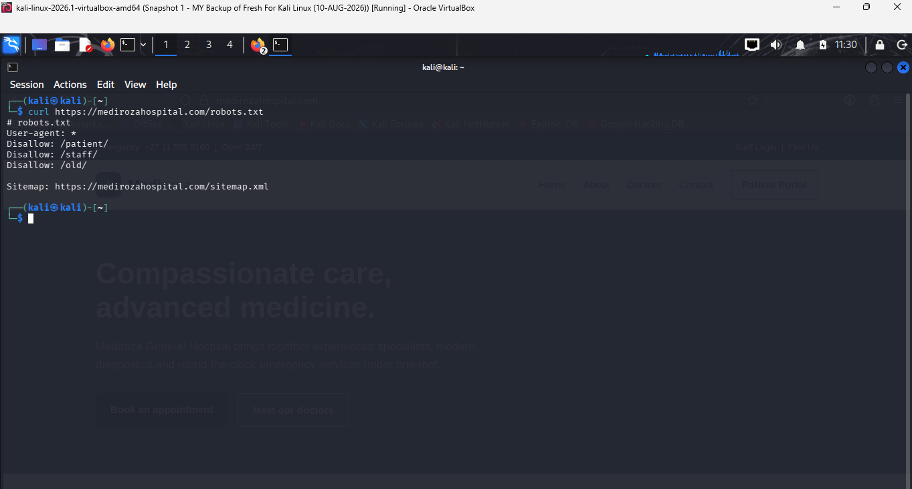

---

###  Finding 1 — Username Enumeration (🟡 Medium)
Different error messages for a wrong username (`Username not found`) versus a wrong password (`Incorrect password`) confirmed `admin` as a valid account.

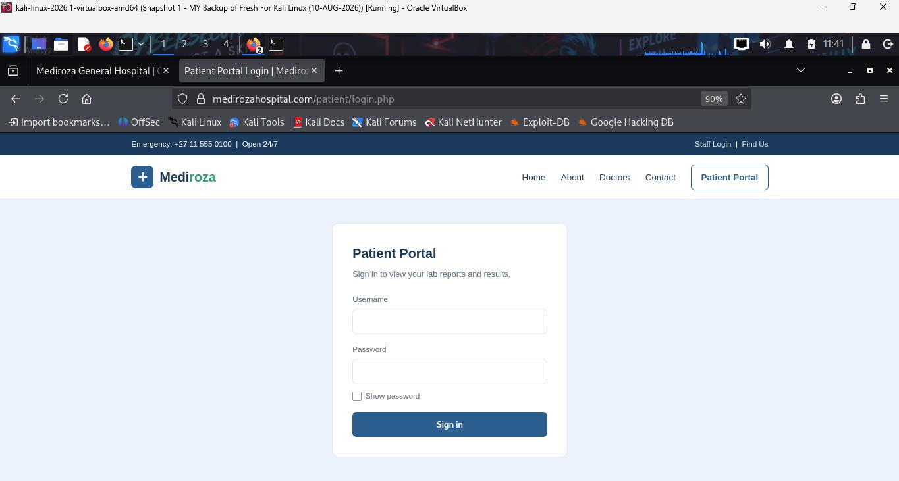

---

###  Finding 2 — SQL Injection Login Bypass (🔴 Critical)
A single quote in the username field broke the backend SQL query and returned a MySQL syntax error, confirming the field was injectable:

```sql
SELECT * FROM users WHERE username='admin'' AND password='password123'
```

The classic bypass payload authenticated as `admin` without any valid password:

```
Username: admin' --
Password: anything
```

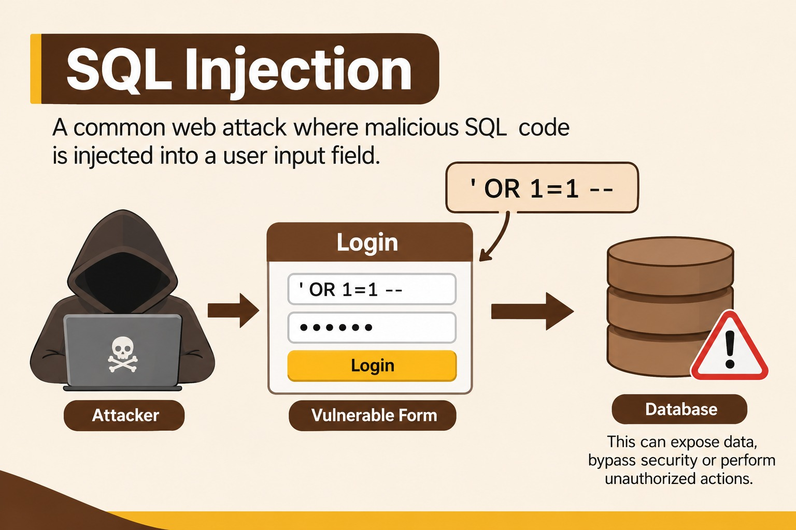

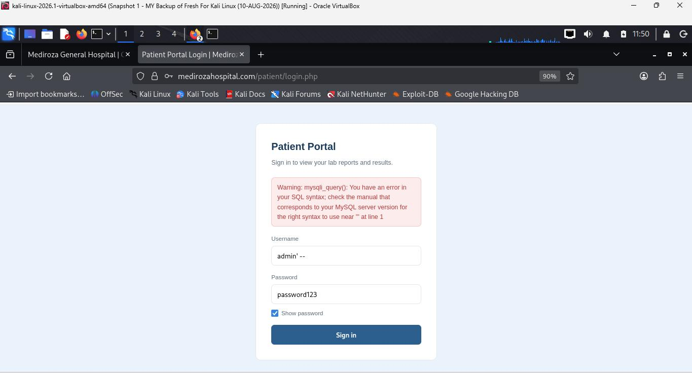

Once authenticated, a directory listing on `/patient/` further exposed the application's server-side files:

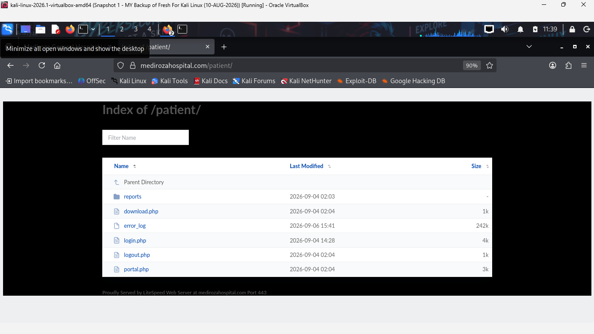

---

###  Finding 3 — Confidential PDFs Exposed (🟠 High)
The bypassed portal served three downloadable, password-protected lab report PDFs.

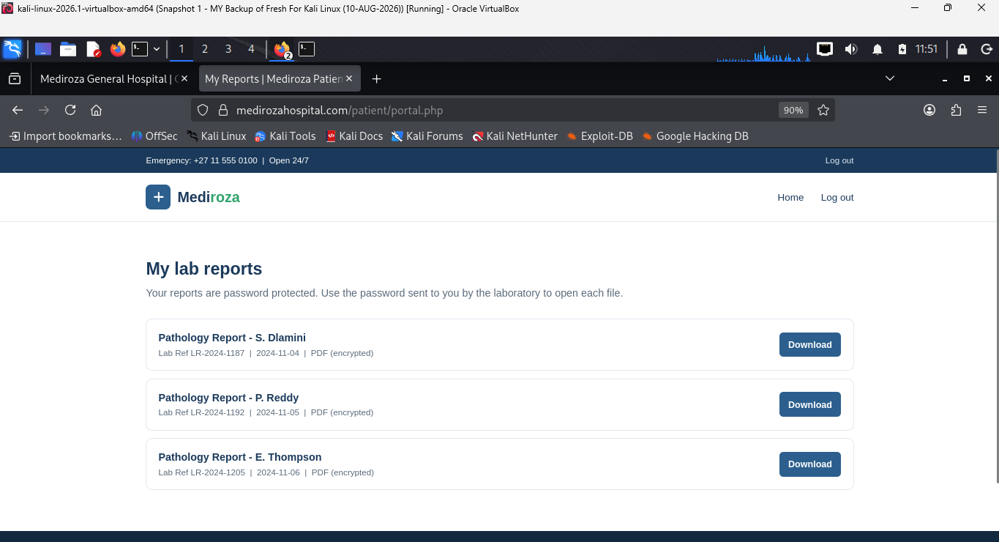
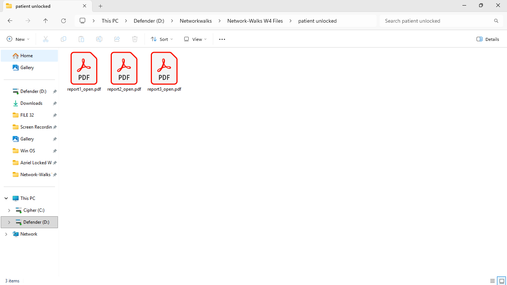
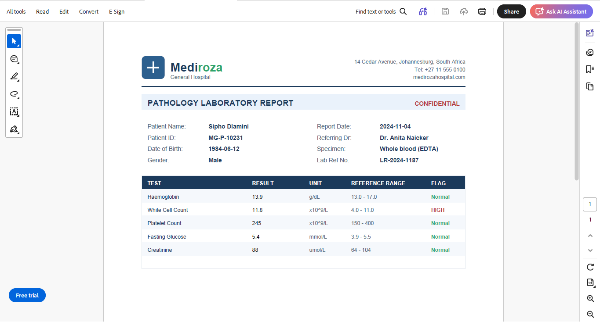

**Decrypted report contents:**

| Report | Patient |
|---|---|
| `patient_report_1.pdf` | Sipho Dlamini |
| `patient_report_2.pdf` | Priya Reddy |
| `patient_report_3.pdf` | Emily Thompson |

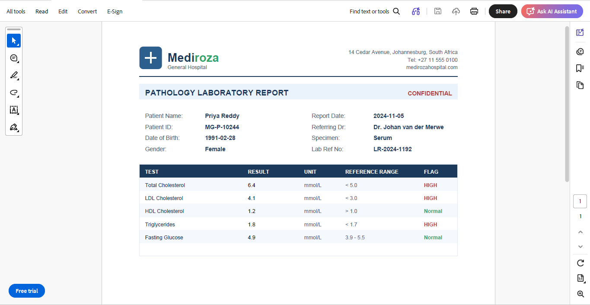
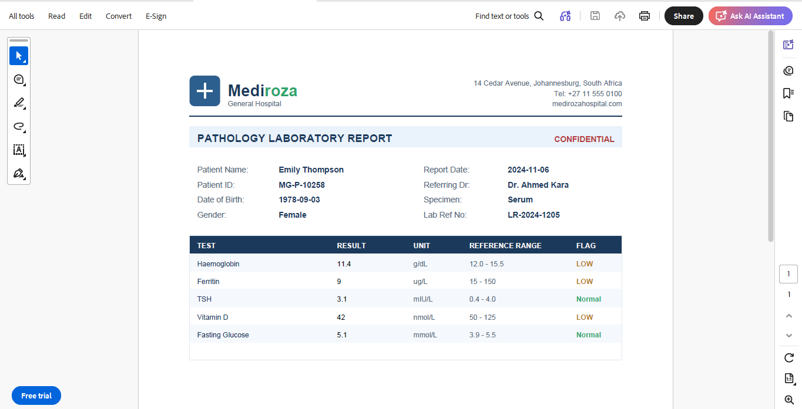
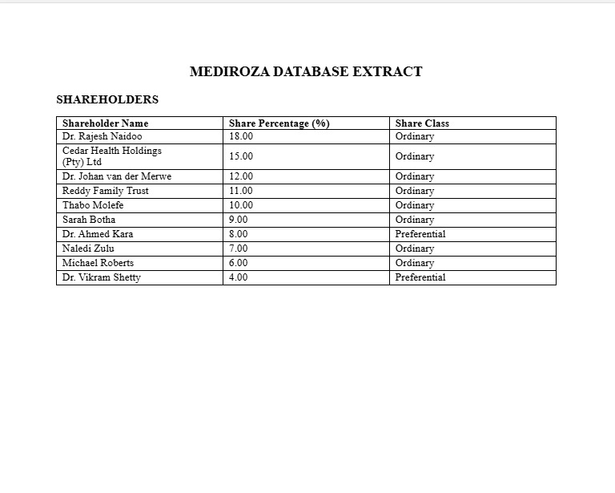

---

###  Finding 4 — Weak PDF Passwords (🟠 High)
All three PDFs cracked trivially using small wordlists:

| File | Cracked Password | Wordlist |
|---|---|---|
| `patient_report_1.pdf` | `123456` | Built-in 100-word list |
| `patient_report_2.pdf` | `password` | Built-in 100-word list |
| `patient_report_3.pdf` | `!@#$%^&` | Extended (JTR default) |

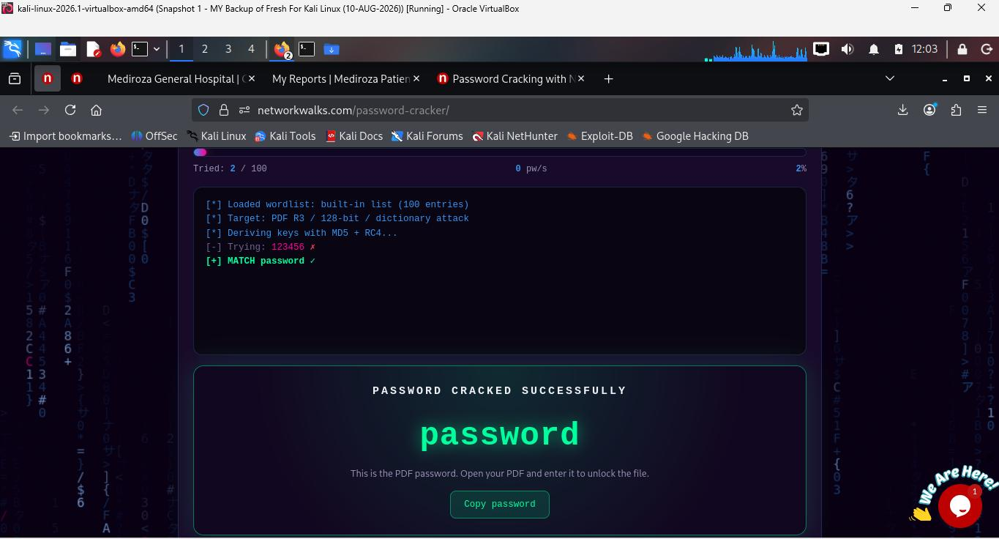
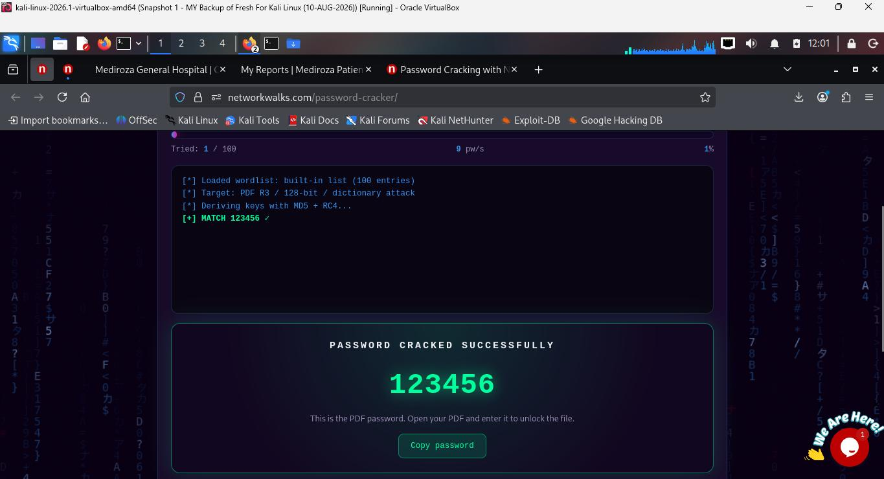
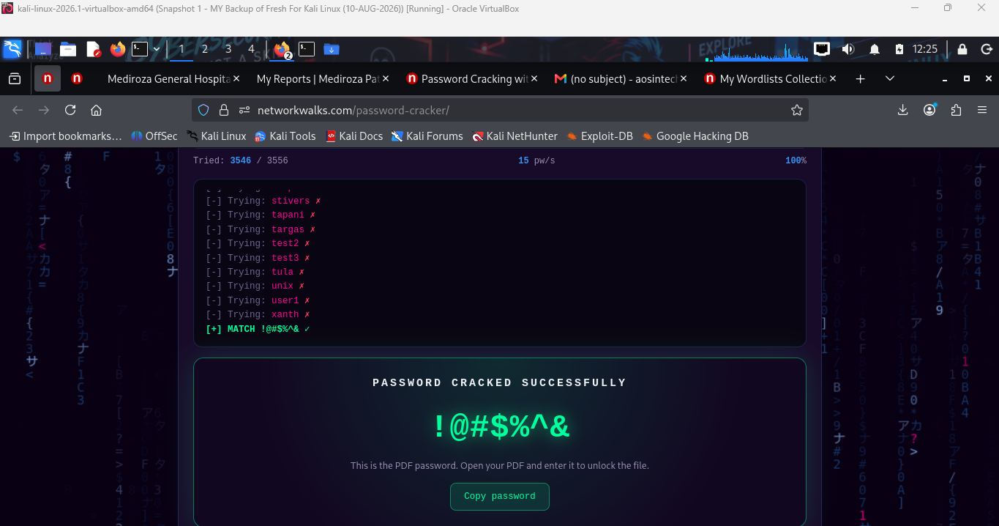

---

###  Finding 5 — Sensitive Metadata in PDFs (🟡 Medium)
`exiftool` revealed hidden metadata in all three reports. Report 3 contained an internal IT comment pointing directly at a server backup location.


**Key leak:**
```
Author:   j.malik
Comments: DB backup moved to /old before site migration, do not delete
```


---

###  Finding 6 — Forgotten Backup, Directory Listing Enabled (🔴 Critical)
Following the metadata lead, `/old/` had directory listing enabled, exposing `mediroza_db_backup_2019.sql` directly to the browser.


---

###  Finding 7 — Staff Salaries & Shareholder Data Leaked (🔴 Critical)
The backup contained **plaintext** names, roles, emails, phone numbers, national ID numbers, and salaries for all 30 staff — plus the full shareholding breakdown for all 10 hospital shareholders. Cross-referencing confirmed `j.malik` (the metadata author) is Jameel Malik, the IT Systems Administrator — tying the entire attack chain together.


**Reconstructed data:**


---

##  Recommendations

| Finding | Fix |
|---|---|
| Username enumeration | Return one generic error ("Invalid credentials") for all failed logins |
| SQL injection | Use parameterized queries / prepared statements (PDO example below) |
| Exposed PDFs | Serve files outside the web root via an authenticated script; enforce 12+ char passwords |
| Metadata leakage | Strip all metadata before distributing files: `exiftool -all= file.pdf` |
| Directory listing | Add `Options -Indexes` in Apache/.htaccess; remove backups from the web root entirely |

```php
// Safe login query — PHP PDO prepared statement
$stmt = $pdo->prepare("SELECT * FROM users WHERE username = ? AND password = ?");
$stmt->execute([$username, $password]);
```

---

##  Conclusion

A complete attack chain — from a single disclosed directory to full financial and ownership data exposure — was achieved using nothing but publicly documented, well-known techniques. All **Critical** and **High** findings should be remediated before this system handles real patient data.

---

##  Credits

| Role | Name |
|---|---|
| **Submitted by** | Usoro, Iniubong Etido |
| **Cybersecurity Mentor** | Waqas Karim, CCIE |
| **Organization** | Networkwalks |
| **Program** | Batch B084 — Week 4 Capstone Project |

> This report was produced as part of a controlled educational exercise by Networkwalks. The target was authorized for security testing. These techniques must never be applied to any system without explicit written permission from the owner.
